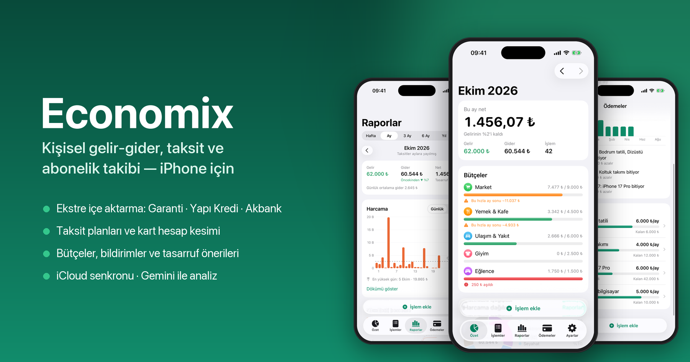
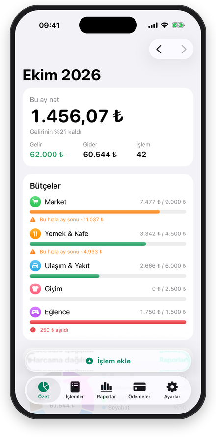
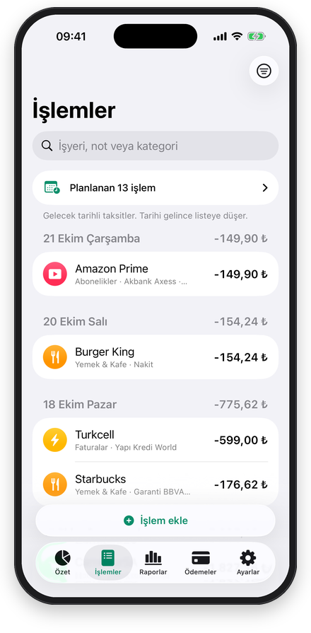
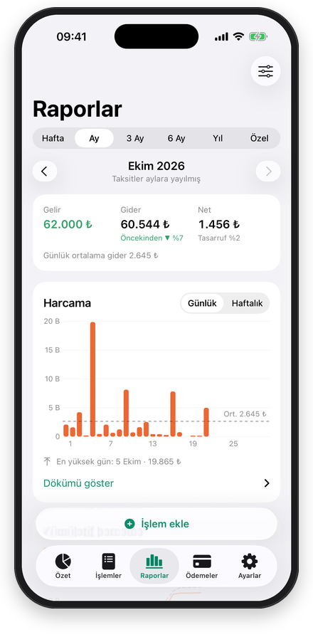
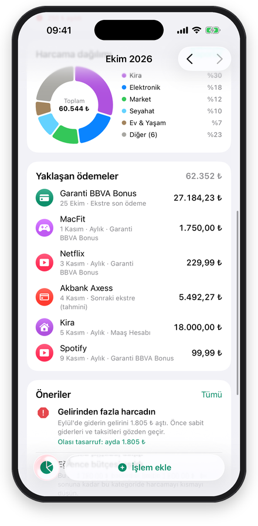
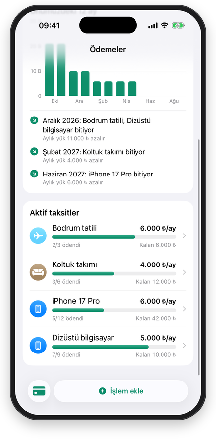
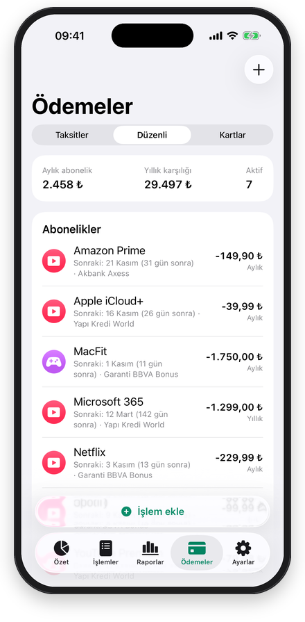
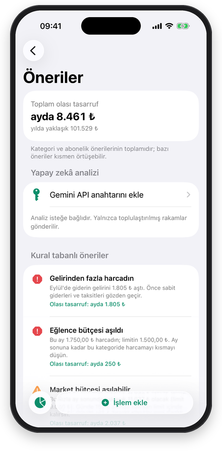
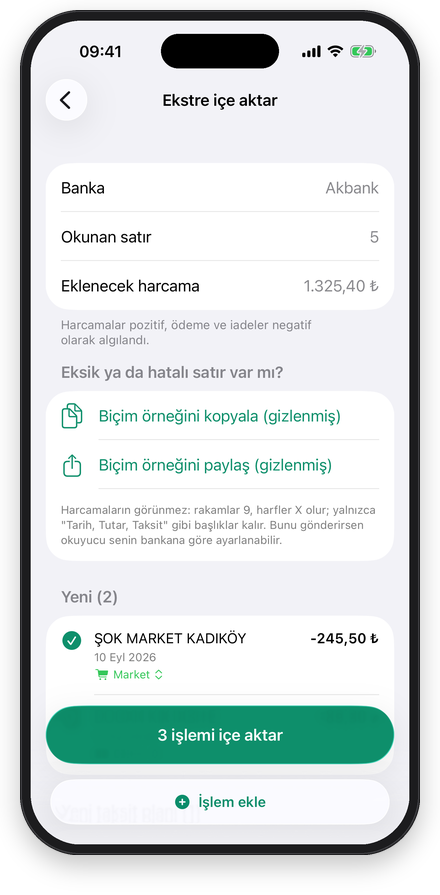
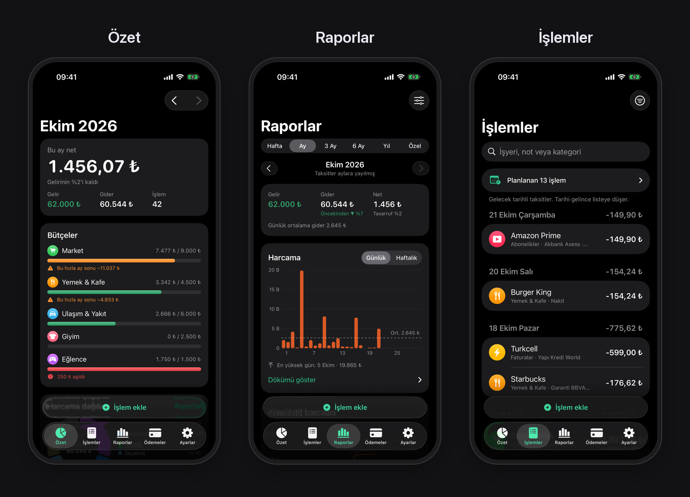

# Economix

<p align="center">
  
</p>

<p align="center">
  
  
  
  
</p>

Kişisel gelir/gider, kredi kartı taksidi ve abonelik takibi için iPhone uygulaması (SwiftUI + SwiftData + iCloud). Tüm veriler cihazda ve kendi iCloud hesabında durur; sunucu yoktur.

*A personal income/expense, credit-card installment and subscription tracker for iPhone. The interface is in Turkish.*

## Ekranlar

<table>
  <tr>
    <td align="center"><br><b>Özet</b><br><sub>Aylık net, bütçeler</sub></td>
    <td align="center"><br><b>İşlemler</b><br><sub>Günlere göre, arama ve filtre</sub></td>
    <td align="center"><br><b>Raporlar</b><br><sub>Günlük, haftalık, aylık harcama</sub></td>
    <td align="center"><br><b>Harcama dağılımı</b><br><sub>Kategoriler, yaklaşan ödemeler</sub></td>
  </tr>
  <tr>
    <td align="center"><br><b>Taksitler</b><br><sub>Aylık yük, biten taksitler</sub></td>
    <td align="center"><br><b>Abonelikler</b><br><sub>Aylık ve yıllık maliyet</sub></td>
    <td align="center"><br><b>Öneriler</b><br><sub>Kural tabanlı ve Gemini</sub></td>
    <td align="center"><br><b>Ekstre içe aktarma</b><br><sub>PDF, Excel, CSV</sub></td>
  </tr>
</table>

<p align="center">
  
  <br><sub>Karanlık mod</sub>
</p>

<sub>Görüntülerdeki tüm veriler uygulamanın demo verisidir (`-demoData`). Yeniden üretmek için: `make readme-images`.</sub>

## Özellikler

- **Özet:** aylık net, bütçeler, kategori dağılımı, yaklaşan ödemeler, tasarruf önerileri
- **İşlemler:** hızlı ekleme; kredi kartında 2–24 taksit; arama ve filtre
- **Raporlar:** hafta, 1/3/6/12 ay ya da başlangıç–bitiş tarihi seçilen özel aralık. Harcama günlük/haftalık/aylık çubuk grafikte ortalama çizgisi ve tutar dökümüyle; kümülatif harcama önceki dönemin aynı günüyle kıyaslanır. Gelir-gider, tasarruf oranı, kategori pasta grafiği ve trendi, haftanın günlerine göre ortalama harcama, en çok harcanan yerler. Taksitler için iki görünüm var: "Aylık yük" (taksitler aylara yayılır) ve "Satın alma" (alım ayında tek tutar).
- **Ödemeler:** taksit planları ve önümüzdeki 12 ayın yükü, abonelikler ve düzenli ödemeler, kart ekstre durumu
- **Bildirimler:** bütçe %80/%100, kart son ödeme, abonelik yenileme, aylık özet
- **Yatırım:** gelir ve giderin yanında ayrı işlem türü. Yatırıma ayrılan para gider sayılmaz; bütçelere, nete ve tasarruf oranına girmez, Özet ve Raporlar'da ayrı gösterilir. Kartla yapılan yatırım alımı kart borcuna eklenir.
- **Bütçe ayı:** Ayarlar > Bütçe ayı'ndan ayın başlangıç günü seçilir (ör. maaş günü 23 → 23 Ekim–22 Kasım). Özet, raporlar, bütçeler, tasarruf önerileri, Gemini analizi ve aylık özet bildirimi bu dönemlere göre hesaplanır. Dönem, günlerinin çoğunun düştüğü ayın adını alır (23 Ekim–22 Kasım → Kasım). Kart hesap kesimi, taksit ve abonelik tarihleri takvim günüyle kalır.
- **Ekstre içe aktarma:** PDF, Excel (.xlsx) ve CSV. Garanti BBVA, Yapı Kredi ve Akbank profilleri; kolonlar tanınmazsa elle eşleme
- **Yapay zekâ analizi (isteğe bağlı):** Google Gemini ile kişisel tasarruf önerileri
- **Face ID kilidi, CSV dışa aktarma**

## Gereksinimler

- Xcode 26.5+, iOS 26 cihaz/simülatör
- [XcodeGen](https://github.com/yonaskolb/XcodeGen). `Makefile`, `~/.local/share/xcodegen-dist/bin/xcodegen` yolunu kullanır. Farklı bir kurulum için: `make XCODEGEN=xcodegen …`
- Ücretli Apple Developer hesabı (iCloud/CloudKit için gerekli). Takım kimliğini `Config/Secrets.xcconfig` içindeki `DEVELOPMENT_TEAM`'e yaz; bu dosya git'e girmez.
- Kendi hesabınla derlerken paket kimliğini (`project.yml` > `bundleIdPrefix`) ve iCloud kapsayıcısını (`project.yml` entitlements ile `ModelContainerFactory.swift`) kendine göre değiştir; `com.furkanfuat.economix` yalnızca bu projenin sahibine aittir.

## Komutlar

| Komut | Ne yapar |
|---|---|
| `make generate` | `project.yml`'dan `Economix.xcodeproj` üretir (proje dosyası git'te tutulmaz) |
| `make core-test` | Saf iş mantığı testleri (`Packages/EconomixCore`, macOS'ta saniyeler sürer) |
| `make test` | SwiftData entegrasyon testleri (simülatör) |
| `make gemini-live` | Uygulamanın gerçek Gemini isteklerini (analiz ve kategori) `Config/Secrets.xcconfig`'teki anahtarla dener |
| `scripts/check-gemini.sh` | Anahtarı ve istek biçimini küçük bir istekle hızlıca dener (anahtar yazdırılmaz) |
| `make demo` | Simülatörde 12 aylık demo veriyle açar (ayrı yerel dosya, iCloud'a gitmez) |
| `make fixtures` | UI testindeki Akbank düzenli örnek PDF'i (`akbank-ornek.pdf`) yeniden üretir |
| `make readme-images` | README'deki ekran görüntülerini ve kapak görselini demo veriyle yeniden üretir (Python + Pillow) |
| `make screens` | Demo veriyle ekranları gezip `build/screens/` altına görüntü kaydeder |
| `make device UDID=…` | Kabloyla bağlı iPhone'a kurar |

## iPhone'a kurulum

1. iPhone'u kabloyla Mac'e bağla ve "Bu bilgisayara güven" de.
2. iPhone'da **Ayarlar > Gizlilik ve Güvenlik > Geliştirici Modu**'nu aç (telefon yeniden başlar).
3. İlk kurulumda bir kez `open Economix.xcodeproj` ile projeyi aç. **Economix** hedefinde **Signing & Capabilities** sekmesinde takımın seçili olduğunu ve iCloud container'ının (`iCloud.com.furkanfuat.ecoomix`) işaretli olduğunu kontrol et. Xcode, App ID'yi ve container'ı geliştirici hesabında oluşturur. Container adı uygulamanın eski yazımıyla kaldı; mevcut iCloud verileri orada durduğu için bilinçli olarak değiştirilmedi.
4. Cihaz kimliğini bul: `xcrun devicectl list devices`
5. Kur: `make device UDID=<cihaz-id>`

Ücretli hesapla kurulan uygulama 1 yıl geçerlidir. Süre dolunca 5. adımı tekrarlaman yeterli; veriler iCloud'da olduğu için kaybolmaz.

### iCloud notları

- Xcode'dan kurulan sürüm CloudKit **Development** ortamını kullanır.
- İleride TestFlight/App Store'a geçersen önce [CloudKit Console](https://icloud.developer.apple.com) üzerinden şemayı **Production**'a deploy et.
- Telefon değişirse ya da uygulama silinip yeniden kurulursa veriler iCloud'dan geri gelir. Varsayılan kategorilerin iki kez oluşması açılışta otomatik birleştirilir.

## Ekstre içe aktarma

1. Bankanın uygulamasından ya da internet şubesinden kart ekstresini **PDF**, **Excel (.xlsx)** ya da **CSV** olarak indir.
2. **Ayarlar > Ekstre içe aktar**'a gir, ilgili kartı seç ve dosyayı seç.
3. Önizlemede satırları kontrol et ve **İçe aktar**'a bas.
   - **Zaten eklenmiş:** daha önce içe aktarılan satırlar.
   - **Muhtemel tekrar:** aynı hesapta, ±2 gün içinde, aynı tutarla elle girdiğin bir işlem var. Eklenmez; senin kaydın ekstreyle eşleştirilir.
   - **Benzer tutar:** tutar ±5 ₺ ya da ±%2 yakın (ör. 245 ₺ girdin, ekstrede 245,28 ₺). İşyeri adı da tutuyorsa aynı alışveriş sayılır, eklenmez ve senin kaydının tutarı ekstredeki kuruşlu tutara düzeltilir. Tutmuyorsa satır eklenir ama "benzer olabilir" notuyla gösterilir; aynıysa işaretini kaldır.
   - Her elle girdiğin kayıt en fazla bir ekstre satırıyla eşleşir; önce tam tutar, sonra en küçük fark aranır. Her satırın altında hangi kaydınla eşleştiği yazar.
   - "TAKSİT 3/6" gibi satırlar mevcut plana bağlanır. Plan yoksa alım tarihi geriye hesaplanarak yeni plan oluşturulur.
   - Karta yapılan ödemeler varsayılan olarak kapalıdır; iadeler gelir olarak eklenir.
   - Bir kartın ekstresini baştan aktarmak için aynı ekranda kartı seçip **Önceki içe aktarımı sil**'e dokun. Ekstreden eklenen işlemler ve taksit planları silinir. Elle girdiğin kayıtlar kalır; yalnızca ekstreyle eşleşmeleri kaldırılır. İstersen o işyerleri için öğrenilen kategoriler de unutulur.
   - Kampanya ödülleri, bonuslar ve chip-para/puan hareketleri ("ilk harcamaya ödül", "Kullanılan chip-para") da ödemeler gibi kapalı gelir. Akbank chip-para kazanımını eksi işareti olmadan ayrı kolonda yazdığı için bu satırlar açıklamadaki kesin ifadelerden tanınır.

**Kategoriler** şu sırayla belirlenir:
1. Senin daha önceki seçimlerin. Aynı markanın başka şube ya da şehir yazımı da tanınır ("MIGROS KADIKÖY" için seçtiğin kategori "MIGROS SANAL MARKET İSTANBUL"a da gelir).
2. Yaygın Türk zincirleri ve "PASTANESİ, KASAP, ECZANESİ, OTOPARKI, KIRTASİYE" gibi genel kelimeler.
3. Önizlemede bir satıra kategori seçince, aynı işyerinin kategorisiz diğer satırları da onu alır.
4. Kalan kategorisiz satırlar için **Gemini ile belirle** düğmesi. Gemini'ye yalnızca işyeri adları ve kategori adların gider; tutar ve tarih gitmez. Gemini emin değilse satırı boş bırakır.

Senin ve Gemini'nin seçtiği kategoriler öğrenilir ve sonraki ekstrelerde otomatik gelir. Sözlükten gelen öneriler öğrenilmez; böylece sözlük düzeldiğinde eski bir hatalı öneri kural olarak kalmaz.

Sözlükte öne çıkanlar:
- **Online Alışveriş:** Hepsiburada/Hepsipay, Amazon (iyzico üzerinden de), N11, Trendyol, Pazarama, Temu, AliExpress ve benzerleri. Alan adlı (`pazarama.com`), bitişik (`AmazonMarketTR`) ve kesik (`HEPSIBU`) yazımlar da tanınır. Trendyol Yemek/Go, HepsiExpress, Amazon Prime ve AWS kendi kategorilerinde kalır.
- **Market:** ŞOK, A101, BİM, Migros, CarrefourSA ve adında market, süpermarket ya da gıda geçen her işyeri.
- **Eğlence:** sinemalar (Cinemaximum, Paribu Cineverse, adında sinema/cinema geçenler), bilet siteleri, tema parkları, oyun mağazaları.
- **Yatırım:** aracı kurum ve kripto alımları (Midas, Binance, BtcTurk, Paribu, adında "yatırım" geçen kurumlar) ayrı "Yatırım" türüne düşer. Getiriler (temettü, faiz, satış kârı) gelirdeki "Yatırım getirisi"ne, burslar "Burs"a girer.
- **Abonelikler:** yapay zekâ ve yazılım servisleri (fal, OpenAI, Midjourney, ElevenLabs, Cursor, Vercel…). Bunlar kullandıkça çekildiği için yalnızca kategori atanır; düzenli ödeme oluşturulmaz.

**Banka kartı (debit):** Ayarlar > Hesaplar ve kartlar > + menüsünde her banka için kredi kartı ve banka kartı şablonu var. Banka kartı harcamaları vadesiz hesap dökümünde görünür. Bu dökümü içe aktarırken bir banka hesabı ya da banka kartı seç; eşleştirme tüm banka hesaplarına ve banka kartlarına elle girdiğin kayıtlara bakar. Kredi kartı ekstresi ise yalnızca o kartın kayıtlarıyla karşılaştırılır.

Eski `.xls` biçimi okunamaz. Dosyayı Numbers'ta açıp CSV ya da .xlsx olarak dışa aktar.

**PDF ekstreler:** Tarihle başlayıp tutarla biten satırlar işlem sayılır. Satırlar sayfadaki konuma göre kurulduğu için sütunlu PDF'ler de okunur. Taksit kolonu ("3/6") ve bonus/puan kolonu ayırt edilir. Taranmış (yalnızca görüntü olan) PDF'ler okunamaz; görüntüden okuma (OCR) bilerek yapılmaz. Okumada sorun olursa önizlemedeki **Biçim örneğini paylaş** düğmesi gizlenmiş bir örnek üretir: rakamlar 9'a, harfler X'e döner, yalnızca başlık kelimeleri kalır. Okuyucu bu örnekle bankana göre ayarlanabilir.

**Akbank (Axess) PDF'leri:** Akbank ekstresi bir IBM ana bilgisayar çıktısıdır. Harfler Type3 bitmap yazı tipleriyle çizilir, kodlar EBCDIC'tir (kod sayfası 1140) ve PDF'te Unicode tablosu yoktur. Bu yüzden PDFKit anlamsız metin verir. Uygulama bu durumda içerik akışını kendisi okur ve kodları EBCDIC tablosuyla çevirir. Tabloda olmayan ı, İ, ş, Ş, ğ ve Ğ harfleri ayrı bir yazı tipinde, belgeye özel kodlarla durur. Bu harfler resimlerinden tanınır: önce gerçek ekstreden öğrenilmiş harf sözlüğüne (`TurkishGlyphs`), yoksa harfin şekline bakılır. ş ile Ş'nin şekli aynıdır, bu yüzden aradaki fark komşu harflerin boyundan anlaşılır.

> Banka profilleri yaygın kolon adlarına göre yazıldı ("Tarih", "İşlem/Açıklama", "Tutar", "Taksit", "Borç/Alacak"). Gerçek bir ekstre düzgün okunmazsa elle eşleme ekranı devreye girer. Kolon düzeni belli olan bir örnek dosyayla profil kesinleştirilebilir (`Packages/EconomixCore/Tests/EconomixCoreTests/Fixtures`).

## Yapay zekâ analizi (Google Gemini)

Anahtarı [aistudio.google.com](https://aistudio.google.com) > **Get API key** üzerinden al ve uygulamada **Ayarlar > Yapay zekâ** alanına yaz. Anahtar yalnızca o cihazın Keychain'inde saklanır; uygulama paketine gömülmez, iCloud'a ve yedeklere gitmez. Her kullanıcı kendi anahtarını kullanır.

Google Cloud Console'da anahtarı **Generative Language API** ile sınırlayıp kota koyman önerilir.

`Config/Secrets.xcconfig` içindeki `GEMINI_API_KEY` yalnızca geliştirici araçları içindir (`make gemini-live`, `scripts/check-gemini.sh`); uygulamaya girmez.

- Analiz yalnızca **Öneriler > Son 6 ayı analiz et** düğmesiyle çalışır. Model düşünerek yanıt verdiği için 1–2 dakika sürebilir.
- Model: `gemini-3.8-flash` (varsayılan) ya da `gemini-4-argon`. Ayarlar'dan seçilir.
- **Gönderilenler:** aylık gelir/gider toplamları, kategori × ay toplamları, bütçeler, abonelik adları ve tutarları, taksit yükü, kural tabanlı bulgular.
- **Gönderilmeyenler:** işlem notları ve tek tek işlemler. İşyeri adları yalnızca ayarlardan izin verilirse gönderilir.
- Ücretsiz katmanda Google gönderilen içeriği ürün geliştirmede kullanabilir. Bunu istemiyorsan AI Studio'da faturalandırmayı aç.

## Mimari

```
Packages/EconomixCore   Saf Swift: para, takvim, kesim döngüsü, taksit, düzenli işlem, rapor,
                       bütçe, tasarruf analizi, AI özeti, CSV/XLSX ekstre çözümleme (+ testler)
Economix/Models         SwiftData modelleri (CloudKit kurallarına uygun)
Economix/Services       LedgerService, RecurringGenerator, ImportService, BudgetMonitor,
                       NotificationScheduler, GeminiAdvisor, CSVExporter, SeedService
Config                 Secrets.example.xcconfig (şablon); Secrets.xcconfig git'e girmez
Economix/Features       SwiftUI ekranları
EconomixTests           SwiftData entegrasyon testleri (bellek içi)
EconomixUITests         Ekran görüntüsü ve içe aktarma akışı testleri
```

Tasarım dokümanı: `docs/superpowers/specs/2026-10-18-economix-design.md`

## Lisans

[MIT](LICENSE). Kullanılan tek dış paket [CoreXLSX](https://github.com/CoreOffice/CoreXLSX) Apache 2.0 lisanslıdır.
